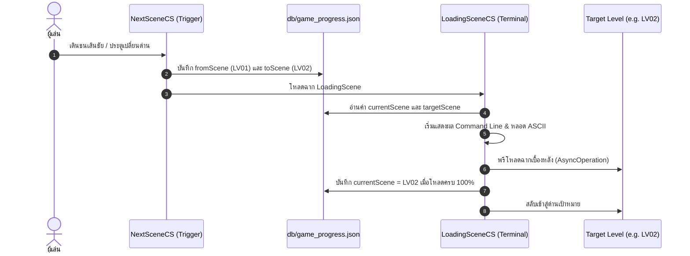

# คู่มือระบบ Database บันทึกฉาก, หน้าโหลดดิ้ง Command Line และการจัดการหัวใจข้ามด่าน (Scene Loading & DB Persistence System)

**วันที่บันทึก:** 31 ตุลาคม 2026  
**โปรเจกต์:** Libellus2D  
**ไฟล์สคริปต์หลัก:**  
- [`Assets/Script/Progress/GameProgressManagerCS.cs`](file:///Users/mac_air_m4/Documents/Unity_Project/Libellus2D/Assets/Script/Progress/GameProgressManagerCS.cs)  
- [`Assets/Script/SetScene/NextSceneCS.cs`](file:///Users/mac_air_m4/Documents/Unity_Project/Libellus2D/Assets/Script/SetScene/NextSceneCS.cs)  
- [`Assets/Script/SetScene/LoadingSceneCS.cs`](file:///Users/mac_air_m4/Documents/Unity_Project/Libellus2D/Assets/Script/SetScene/LoadingSceneCS.cs)  
- [`Assets/Script/Player/PlayerHealthCS.cs`](file:///Users/mac_air_m4/Documents/Unity_Project/Libellus2D/Assets/Script/Player/PlayerHealthCS.cs)  
- [`Assets/Script/UI/GameOverManagerCS.cs`](file:///Users/mac_air_m4/Documents/Unity_Project/Libellus2D/Assets/Script/UI/GameOverManagerCS.cs)  
**ไฟล์ฐานข้อมูล (Database JSON):**  
- [`db/game_progress.json`](file:///Users/mac_air_m4/Documents/Unity_Project/Libellus2D/db/game_progress.json)  
- [`db/player_health.json`](file:///Users/mac_air_m4/Documents/Unity_Project/Libellus2D/db/player_health.json)  
**ฉากเกี่ยวข้อง:**  
- [`Assets/Scenes/LoadingScene.unity`](file:///Users/mac_air_m4/Documents/Unity_Project/Libellus2D/Assets/Scenes/LoadingScene.unity)  

---

## 1. ภาพรวมการปรับปรุงระบบ (Overview)

การอัปเดตครั้งนี้มุ่งเน้นการเชื่อมโยงระบบฐานข้อมูลความคืบหน้า (Database Persistence) เข้ากับขั้นตอนการเปลี่ยนฉากและการสร้างประสบการณ์การโหลดด่าน (Loading Experience) สไตล์ **Command Line Terminal / Retro Hacker**:
1. **ระบบ DB ความคืบหน้า (`game_progress.json`):** บันทึกทั้งด่านที่เราอยู่ (`currentScene`) และด่านปลายทางที่เรากำลังจะส่งผู้เล่นไป (`targetScene`)
2. **การทำงานร่วมกันระหว่าง `NextSceneCS` และ `LoadingSceneCS`:** เมื่อผู้เล่นแตะจุดเปลี่ยนฉาก จะส่งข้อมูลผ่าน DB แล้วนำผู้เล่นเข้าสู่หน้าโหลดดิ้งหลอกๆ ก่อนเข้าด่านจริง
3. **หน้าจอ Loading สไตล์ Command Line:** แสดงผลแบบคอนโซลพิมพ์ Log ทีละบรรทัด พร้อมแถบ ASCII Loading Bar และ Cursor กระพริบแบบไดนามิก
4. **กฎการรีเซ็ตเลือด 3 หัวใจ (`player_health.json`):** ผู้เล่นจะเริ่มต้นและเกิดใหม่ที่ 3 หัวใจเฉพาะด่าน `LV00` และ `LV01` เท่านั้น หากเป็นด่านอื่น (เช่น `LV02`, `BossLV01`) จะรักษาจำนวนหัวใจสูงสุด (`maxHearts`) ที่สะสมมาไว้ และคืนเลือดเต็มหลอดเมื่อเริ่มใหม่

---

## 2. โครงสร้าง Database ความคืบหน้า (`db/game_progress.json`)

โครงสร้างข้อมูลใน `GameProgressData` ได้รับการขยายให้รองรับการเปลี่ยนผ่านของฉาก:

```json
{
    "currentScene": "LV01",
    "targetScene": "LV02",
    "highestUnlockedScene": "LV01",
    "clearedStages": [],
    "defeatedBosses": [],
    "lastSaveTimestamp": "2026-10-31 21:25:00"
}
```

### ฟังก์ชัน API หลักใน `GameProgressManagerCS`:
- **`GameProgressManagerCS.SaveSceneTransition(string fromScene, string toScene)`**:  
  บันทึกด่านต้นทางที่เราอยู่ และด่านเป้าหมายที่จะส่งไปพร้อมกันในคำสั่งเดียว
- **`GameProgressManagerCS.GetTargetSceneName(string fallback = "LV01")`**:  
  ดึงชื่อด่านปลายทางที่หน้า Loading ต้องโหลดไป
- **`GameProgressManagerCS.GetCurrentSceneName(string fallback = "LV01")`**:  
  ดึงชื่อด่านต้นทางที่ผู้เล่นเพิ่งจากมา
- **ป้องกันการบันทึกทับผิดพลาด (`AutoSaveCurrentScene`)**:  
  ระบบจะไม่บันทึกทับฉากปัจจุบันหากผู้เล่นกำลังอยู่ในหน้า `Lobby` หรือหน้า `LoadingScene`

---

## 3. การทำงานร่วมกันของ `NextSceneCS` และ `LoadingSceneCS`



### การตั้งค่าใน `NextSceneCS.cs`:
- **`nextSceneName`**: ชื่อด่านปลายทาง เช่น `LV02`, `BossLV01`
- **`useLoadingScene`**: เปิดใช้งานการส่งผ่านหน้าโหลดดิ้ง (ค่าเริ่มต้น: `true`)
- **`loadingSceneName`**: ชื่อฉากหน้าโหลดดิ้ง (ค่าเริ่มต้น: `LoadingScene`)
- **`markCurrentStageCleared`**: บันทึกว่าผ่านด่านปัจจุบันลงในฐานข้อมูลทันทีเมื่อชนจุดเปลี่ยนฉาก

---

## 4. หน้าโหลดดิ้ง Command Line / Terminal Interface (`LoadingSceneCS`)

หน้าโหลดดิ้งถูกออกแบบให้แสดงผลเสมือนหน้าจอคอมพิวเตอร์เทอร์มินัล โดยพิมพ์ชุดคำสั่งและสถานะการเชื่อมต่อออกมาทีละบรรทัด:

```text
=== LIBELLUS-OS [Kernel v2.4.0-PROD] (x86_64-libellus-core) ===
> [SYS_INIT] Mounting filesystem /dev/sda1 ... [OK]
> [DB_SYSCALL] Reading 'db/game_progress.json' ... [LOADED]
> [SECTOR_ORIGIN] Current Level: LV01
> [SECTOR_TARGET] Destination: LV02
> [DB_SYSCALL] Validating profile in 'db/player_health.json' ... [OK]
> [MEMORY] Allocating scene buffer blocks & physics matrix...
> [STREAM_LOAD] Transferring asset packages & shaders to GPU...

> [TRANSFER] [====================>] 100%
> [STREAM_LOAD] Scene assets decompressed & compiled. [COMPLETE]
> [STATUS] Sector jump matrix to LV02 verified. [READY]

> [BOOT] Access granted. Transporting to LV02 now..._
```

### คุณสมบัติเด่นของ `LoadingSceneCS`:
1. **ระบบสร้าง UI อัตโนมัติ (`autoBuildTerminalUI`):**  
   หากในฉาก `LoadingScene.unity` ยังไม่มี UI Component ใดๆ สคริปต์จะสร้าง Canvas พื้นหลังสีดำสไตล์ CRT Console พร้อมแถบ Header และ TextMeshPro สีเขียว Retro Terminal ให้อัตโนมัติทันที
2. **ASCII Loading Bar:**  
   แถบความคืบหน้าตัวอักษรแบบไดนามิก เช่น `[=========>           ] 45%` วิ่งสอดคล้องกับเวลาโหลดจริงและ `fakeLoadingDuration`
3. **Blinking Cursor:**  
   เคอร์เซอร์กระพริบ `_` ที่ส่วนท้ายของข้อความ ช่วยเพิ่มบรรยากาศแบบ Command Line สมจริง
4. **โหมดรอการกดปุ่ม (`waitForUserInput`):**  
   สามารถติ๊กถูกเพื่อให้ระบบรอผู้เล่นกดปุ่ม Spacebar หรือคลิกเมาก่อนกระโดดเข้าสู่ด่านจริง

---

## 5. กฎระบบพลังชีวิตผู้เล่น (`db/player_health.json`)

ตามข้อกำหนดใหม่: **ผู้เล่นจะเริ่มต้น และตายเริ่มใหม่ที่ 3 หัวใจแค่ด่าน `LV00` และ `LV01` เท่านั้น**

| สถานการณ์ | ด่าน LV00 / LV01 | ด่านอื่นๆ (LV02, BossLV01 ฯลฯ) |
| :--- | :--- | :--- |
| **เข้าเล่นด่านครั้งแรก (`Start()`)** | รีเซ็ตเป็น **3/3 หัวใจ** เสมอ | โหลดค่าเลือดและ **`maxHearts` เดิม** จากเซฟ |
| **ตายแล้วกด Retry (`RestartStage()`)** | เริ่มต้นใหม่ที่ **3/3 หัวใจ** | คืนเลือดเต็มตาม **`maxHearts` เดิม** ที่สะสมมา (เช่น มี 5 หลอด ก็ได้ 5/5) |
| **ตายแล้วกลับล็อบบี้ (`GoToLobby()`)** | บันทึกเลือดเริ่มต้น 3/3 | รักษา `maxHearts` เดิมไว้ใน JSON ไม่ลบทิ้ง |

### จุดที่ปรับปรุงในโค้ด:
- **[`PlayerHealthCS.cs`](file:///Users/mac_air_m4/Documents/Unity_Project/Libellus2D/Assets/Script/Player/PlayerHealthCS.cs):**
  - เพิ่มฟังก์ชันตรวจสอบ `IsResetToThreeHeartsScene(sceneName)`
  - เพิ่มฟังก์ชัน `ResetHealthForDeathRestart(sceneName)` เพื่อกู้คืนเลือดตามระดับ `maxHearts` โดยไม่ลบไฟล์เซฟทิ้งอย่างไร้เงื่อนไข
- **[`GameOverManagerCS.cs`](file:///Users/mac_air_m4/Documents/Unity_Project/Libellus2D/Assets/Script/UI/GameOverManagerCS.cs):**
  - ในฟังก์ชัน `RestartStage()` และ `GoToLobby()` เปลี่ยนจากการสั่ง `File.Delete(savePath)` เป็นการเรียก `PlayerHealthCS.ResetHealthForDeathRestart(currentScene)` เพื่อไม่ให้ `maxHearts` ของผู้เล่นสูญหายเมื่อตายในด่านระดับสูง

